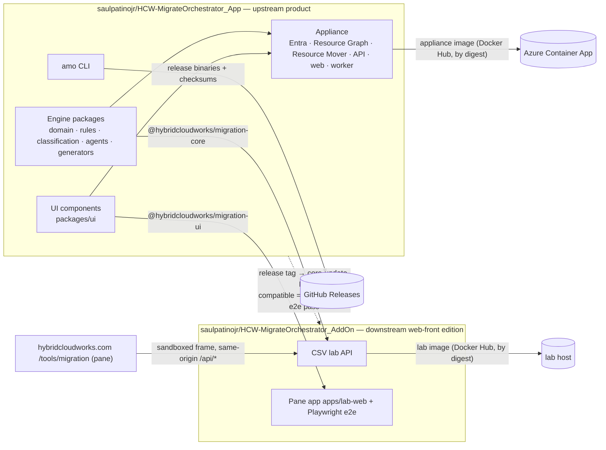

# Azure Migration Orchestrator

**Appliance and migration intelligence core — the upstream product.**

[](https://github.com/saulpatinojr/HCW-MigrateOrchestrator_App/actions/workflows/ci.yml)
[](https://github.com/saulpatinojr/HCW-MigrateOrchestrator_App/actions/workflows/security.yml)
[](https://github.com/saulpatinojr/HCW-MigrateOrchestrator_App/releases)
[](docs/adr/ADR-0029-node-26-runtime-floor.md)
[](https://github.com/saulpatinojr/HCW-MigrateOrchestrator_App/releases/latest)
[](https://hybridcloudworks.com/tools/migration)
[](https://hub.docker.com/r/hybridcloudworks/img-mo-appliance-app)
[](LICENSE)
[](https://github.com/saulpatinojr/HCW-MigrateOrchestrator_AddOn)

**New here?** Give it an inventory of an Azure environment and it tells you, resource by resource, how each one can be
moved and what to watch out for, with the evidence behind every answer. You can try that today without installing
anything: [hybridcloudworks.com/tools/migration](https://hybridcloudworks.com/tools/migration) takes the CSV the Azure
portal exports and shows the plan. This repository is the full product behind it, for teams that want the same
answers from a live, signed-in view of their own estate.

For every Azure resource in an estate, the engine answers *how it moves*: ARM move, Resource Mover, Azure Migrate or another
service, ASR (DR only), a database or data mechanism, recreate the infrastructure, migrate the data separately, rebuild
identity / network / DNS / configuration — or retain, retire, replace, redesign, escalate. Each answer carries evidence,
missing information, a confidence band, prerequisites, risks, validation and rollback steps, and generated Terraform,
PowerShell, CLI and runbooks. "Unsupported" is never the final answer.

This repository holds the **appliance** — authenticated, read-only-by-default assessment of real Azure estates with
approval-gated planning — together with the engine it is built on: taxonomy, versioned Microsoft-Learn-sourced rules,
classification, 19 bounded agents and a Safety Agent, report and infrastructure generators, the `amo` CLI and the React
explorer components. It builds and runs on its own.

Who can use the appliance: every call except the health and agent-list routes needs a valid Microsoft Entra token **that
carries an app role** (`Migration.Read`, `Migration.Plan`, `Migration.Execute` or `Migration.Execute.Destructive`; the lowest, `Migration.Read`, is assess only). A valid token with no
role, or an unknown one, is answered with 403; there is no default access for a signed-in user. Terraform also turns on
"assignment required" for the Entra application as a first layer (the role check in the API is the authoritative control). See
[`docs/deployment/enterprise.md`](docs/deployment/enterprise.md) (sections 2 and 2d) and ADR-0031 and ADR-0032. **The Terraform has never been applied:** a sandbox apply is pending (the Container Apps environment is a workload-profile environment, [issue 82](https://github.com/saulpatinojr/HCW-MigrateOrchestrator_App/issues/82)).

> **Status:** reference implementation, not production. Sign-in, Resource Graph and Resource Mover are implemented against
> REST with fakes in tests; nothing has been validated against a live tenant yet. Every limitation is recorded in
> [`VALIDATION.md`](VALIDATION.md).

## The two repositories



| Repository | Role | Publishes |
|---|---|---|
| **`HCW-MigrateOrchestrator_App`** (this one) | Upstream: engine, rules, CLI, UI components, appliance. Freestanding. | `@hybridcloudworks/migration-core`, `@hybridcloudworks/migration-ui`, CLI binaries, appliance image |
| [`HCW-MigrateOrchestrator_AddOn`](https://github.com/saulpatinojr/HCW-MigrateOrchestrator_AddOn) | Downstream: the slim web-front edition — CSV lab API and the pane framed at hybridcloudworks.com/tools/migration. Freestanding in deployment; depends on the two package tarballs attached to this repository's GitHub Release of each `v*` tag, pinned by URL and integrity hash and adopted through its `core-update` workflow. | Lab image |

**Updates flow downstream.** Every release here is picked up by the addon's `core-update` workflow, which installs the
release's package tarballs, runs the addon's unit tests and browser e2e, and opens a pull request bumping the pin labelled
`compatible` or `needs-adaptation`. Nothing is ever consumed from `main`. The Azure clients never leave this repository,
so the addon is technically unable to reach Azure. Decision records: [ADR-0028](docs/adr/ADR-0028-appliance-upstream-web-front-downstream.md),
[ADR-0008](docs/adr/ADR-0008-hard-edition-boundary-the-demo-cannot-construct-an-azure-provider.md).

## Quick start

Requires Node 26 or newer ([ADR-0029](docs/adr/ADR-0029-node-26-runtime-floor.md)) or the devcontainer. Check yours first with `node --version`; it must print `v26` or higher. The repository's `.npmrc` sets `engine-strict=true`, so `npm ci` on an older Node stops with an "Unsupported engine" error instead of carrying on.

```bash
npm ci && npm test                       # build, assemble the publishable packages, run the tests
npm run rules:validate                   # 35 rules, checksummed snapshot
npm run packages:verify                  # pack both packages and exercise them from an empty consumer project
node apps/cli/dist/main.js assess --csv samples/resources-csv/sample-resources.csv --out ./out --region westus3 --zip
npm run web:build                        # appliance web UI (Vite + React + MSAL)
docker compose -f docker-compose.appliance.yml up --build
```

PowerShell: `npm ci; npm test; npm run rules:validate; node apps/cli/dist/main.js assess --csv samples/resources-csv/sample-resources.csv --out .\out --region westus3 --zip`

No Node at run time: download `amo-linux-x64`, `amo-darwin-arm64` or `amo-windows-x64.exe` and its `SHA256SUMS-*.txt` from
the [latest release](https://github.com/saulpatinojr/HCW-MigrateOrchestrator_App/releases/latest), then
`./amo-linux-x64 assess --csv inventory.csv --out ./out --region westus3`.

## Repository map

| Path | What |
|---|---|
| `packages/domain` · `contracts` · `csv-ingestion` · `evidence-engine` · [`rules/`](rules) | Taxonomy, API contracts, hardened `resources.csv` parser, versioned and checksummed rules with Microsoft Learn provenance |
| `packages/classification-engine` · `agents` · `{report,terraform,runbook,artifact}-*` | Decisions, confidence, waves; orchestrator and Safety Agent; the output bundle |
| `packages/authorization` · `workspace-provider` · `observability` · `azure-discovery` | Levels and approval gate, Coder abstraction, redacted logging, the `DiscoveryProvider` **interface** |
| `packages/ui` | The explorer components, published as `@hybridcloudworks/migration-ui` |
| `packages/azure-auth` · `azure-arm` · `azure-execution` | Entra token validation and credentials, Resource Graph / ARM validate-move / scope clients, gated Resource Mover. **Never published** |
| `apps/cli` · `apps/appliance-api` · `apps/appliance-web` · `apps/worker` | Entry points |
| `scripts/assemble-packages.mjs` → `dist-packages/` | Builds the two npm packages from the workspaces (part of `npm run build`) |
| [`infrastructure/`](infrastructure/README.md) | Appliance Dockerfile and Container Apps Terraform |
| [`docs/`](docs/README.md) | Requirement ledger, traceability, the canonical ADR log for both repositories, agents, product, release runbooks, [`WORKING-PLAN.md`](WORKING-PLAN.md) |

## Releases and artifacts

A `v*` tag publishes the CLI binaries and the two packages, only after the checks pass. The appliance image is the one
artifact that does **not** ship with every tag; the next section says exactly which tags have one.

| Artifact | Where | Gate |
|---|---|---|
| Appliance image | `docker.io/hybridcloudworks/img-mo-appliance-app` | Built locally, scanned (Trivy, HIGH/CRITICAL fixed), then pushed through the Docker OIDC connection with provenance and SBOM (`docs/release/docker-hub.md`). Deploy by digest, never by tag. **Only for a tag pushed while the repository variable `DOCKERHUB_ENABLED` is `true`** (see "Which tags have an appliance image"). Terraform refuses any `image_ref` that is not an exact digest |
| CLI binaries | GitHub Releases, three platforms, with `SHA256SUMS-*.txt`, signed build provenance and a signed CycloneDX SBOM (`amo-cli-<version>.cdx.json`) | Each binary smoke-tested (`rules validate` + a sample `assess`) |
| `@hybridcloudworks/migration-core`, `@hybridcloudworks/migration-ui` | GitHub Release assets (`hybridcloudworks-migration-{core,ui}-<version>.tgz`) with signed build provenance and a signed CycloneDX SBOM (`hybridcloudworks-migration-packages-<version>.cdx.json`); the downstream edition pins them by URL and hash. npm publishing is optional ([`docs/release/npm-publishing.md`](docs/release/npm-publishing.md)) | Clean-consumer gate (`npm run packages:verify`) against the packed tarballs before release and again against the released tarballs |

The GitHub Release is created by one job, as a draft, and made public only after the files and their attestations have been checked; the tag, the package version and `main` must agree before the release workflow builds anything. The release, npm and image workflows start from the same tag and run independently of each other (npm can publish even if the release run fails), each with its own version check first. How to rehearse a release without publishing, how to cut one and what to do when a step fails: [`docs/release/README.md`](docs/release/README.md) (design: ADR-0034).

### Which tags have an appliance image

An image exists for a `v*` tag only if the `publish-images` workflow ran (not "skipped") for that tag. It runs only when the
repository variable `DOCKERHUB_ENABLED` is `true` when the tag is pushed; with it unset the job is skipped, not failed.
State on 2026-10-25 (ticket #42):

| Tag | Appliance image on Docker Hub |
|---|---|
| `v0.2.0`, `v0.2.1` | None. These were pushed to GitHub Container Registry, before the move to Docker Hub on 2026-10-10 (`docs/release/docker-hub.md`) |
| `v0.3.0`, `v0.3.1` | None. `publish-images` was skipped for both because the variable was not set (the tags exist and cannot be changed) |
| The next `v*` tag | Yes, if `DOCKERHUB_ENABLED` is still `true` and `DOCKERHUB_CONNECTION` still holds the Docker OIDC connection ID. Both were set on 2026-10-25. This is the first Docker Hub image: the repository `hybridcloudworks/img-mo-appliance-app` exists, is public and holds no image yet |

To check a tag yourself: open the [publish-images runs](https://github.com/saulpatinojr/HCW-MigrateOrchestrator_App/actions/workflows/publish-images.yml)
and confirm the run for that tag says "success" and ends with a line `docker.io/hybridcloudworks/img-mo-appliance-app@sha256:...`;
then check the signature of that exact digest (PowerShell or bash, with the digest from the run summary):

```bash
gh attestation verify oci://docker.io/hybridcloudworks/img-mo-appliance-app@sha256:<digest-from-the-run-summary> --repo saulpatinojr/HCW-MigrateOrchestrator_App
```

If the run for a tag says "skipped", that tag has no image: use the latest tag that has one, or the owner steps in
[`docs/release/docker-hub.md`](docs/release/docker-hub.md).

Actions are pinned to commit SHAs; Dependabot keeps them current.

## Principles baked into code

Read-only default · the web-front edition is technically unable to reach Azure · infrastructure, identity, configuration
and data are decided separately · migration ≠ DR (ASR is never a default migration tool) · unknown stays unknown · low
evidence never yields high confidence · every output is labelled, hashed and traceable to rule versions · nothing
generated is "production-ready" until validated · deterministic rules decide; language models never decide.

## Contributing, security, license

[`CONTRIBUTING.md`](CONTRIBUTING.md) · [`SECURITY.md`](SECURITY.md) (private vulnerability reporting) ·
[`CODE_OF_CONDUCT.md`](CODE_OF_CONDUCT.md) · MIT ([`LICENSE`](LICENSE), [`NOTICE`](NOTICE)).
Coding-agent guidance: [`AGENTS.md`](AGENTS.md), [`CLAUDE.md`](CLAUDE.md).
